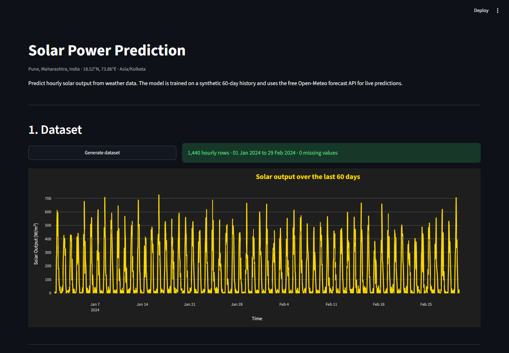
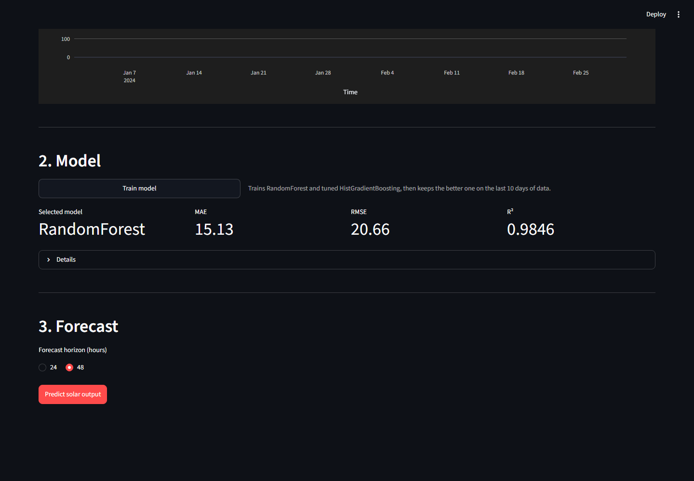
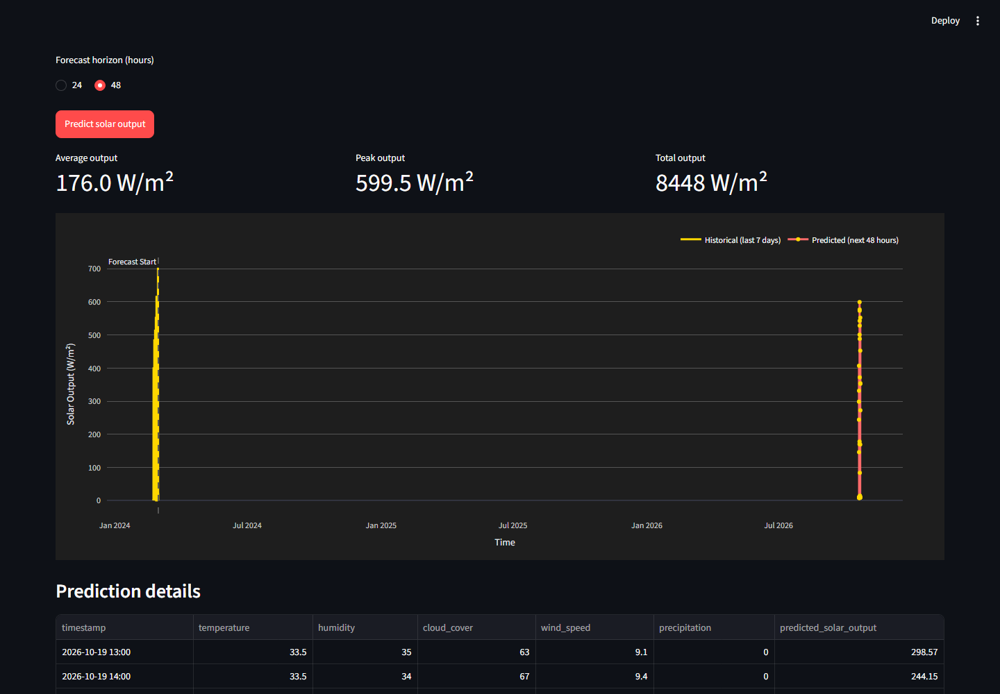
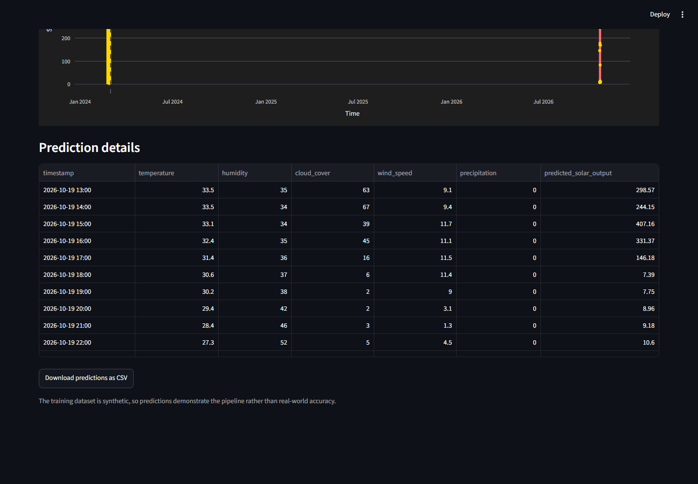

# Solar Power Prediction

A small end-to-end machine learning project that predicts hourly solar power
output for Pune (18.52°N, 73.86°E) from weather data.

It loads a synthetic 60-day weather history, cleans it, engineers time-based
features, trains and compares two regression models, fetches a live hourly
forecast from the free Open-Meteo API, and shows the historical and predicted
output together in a Streamlit dashboard.

---

## Quick start

You need Python 3.13 and a terminal. Every command below is run from the project
folder.

**Step 1 — install the dependencies**

```bash
python -m venv .venv
.venv\Scripts\activate          # Windows (cmd / PowerShell)
# source .venv/bin/activate     # Linux / macOS

pip install -r requirements.txt
```

**Step 2 — generate the dataset**

```bash
python scripts/generate_dataset.py
```

This writes `data/solar_weather_dataset.csv`: 1,440 hourly rows (1 Jan 2024 to
29 Feb 2024). The seed is fixed, so the file is always identical.

**Step 3 — train the model**

```bash
python scripts/train_model.py
```

Trains RandomForest and a tuned HistGradientBoosting model, keeps the better one
on the last 10 days of data, prints MAE / RMSE / R², and saves the model plus
its metadata into `artifacts/`.

**Step 4 — start the dashboard**

```bash
streamlit run app.py
```

Open <http://localhost:8501>. The dashboard is a single page with three steps:
generate the dataset, train the model, and predict.

**Step 5 — check the tests (optional)**

```bash
python -m pytest tests/ -q      # 55 passed
```

---

## Screenshots

**1. Dataset** — the button regenerates the CSV and the chart shows the full
60-day history.



**2. Model** — after training, the selected model and its validation metrics are
shown, with the split dates, tuning details and feature list in the expander.



**3. Forecast** — pick 24 or 48 hours and press *Predict solar output*. The
historical output and the forecast are drawn on the same time axis.



The prediction table below the chart can be downloaded as CSV.



---

## How it works

1. **Data** – `scripts/generate_dataset.py` builds the CSV. Weather values are
   sampled with NumPy, daylight drives the solar output, and random noise is
   added so the data is not clean.
2. **Cleaning and features** – `src/solar_prediction/data_processing.py`
   parses timestamps, drops duplicates, reindexes to a complete hourly range,
   fills missing values with the column median, caps outliers with 1.5×IQR
   bounds, and adds `hour_sine`, `hour_cosine`, `day_of_week`, `weekend` and
   `hour_of_day`.
3. **Training** – `src/solar_prediction/model_training.py` splits the data
   chronologically (first 50 days train, last 10 days validate), tunes
   HistGradientBoosting with `GridSearchCV` over a time-series split, compares
   it against RandomForest on validation R² and saves the winner.
4. **Live weather** – `src/solar_prediction/weather_service.py` calls the
   Open-Meteo forecast endpoint for the next 24 or 48 hours and maps
   `temperature_2m`, `relative_humidity_2m`, `cloud_cover`, `wind_speed_10m`
   and `precipitation` to the model's feature names. Responses are cached for
   an hour.
5. **Prediction** – `src/solar_prediction/prediction.py` applies the same
   feature engineering to the forecast, predicts, and clips the output with
   `np.clip(pred, 0, None)` so it can never be negative.

---

## Weather API

The project uses **Open-Meteo** (`https://api.open-meteo.com/v1/forecast`),
which is free and does not require an API key or a sign-up, so there is nothing
to configure and no secret to keep out of the repository.

Timeouts (5 s connect / 15 s read), connection errors, HTTP errors and 429 rate
limits are all handled. If a field comes back as `null` it is replaced with a
documented default, and if the API is unreachable the prediction falls back to
the synthetic weather history — the dashboard shows a warning when that happens.

---

## Model results

Chronological validation on 20–29 Feb 2024 (240 unseen hours):

| Metric | Value |
|---|---|
| Selected model | RandomForestRegressor |
| MAE | 15.13 W/m² |
| RMSE | 20.66 W/m² |
| R² | 0.9846 |

HistGradientBoosting was tuned with `TimeSeriesSplit(n_splits=3)` and finished
with a best cross-validated MAE of 16.51 (`max_iter=100`, `learning_rate=0.1`,
`max_depth=4`), so RandomForest was kept. The full metrics and tuning record are
saved in `artifacts/solar_model_metadata.joblib`.

---

## Sample output

The first 24 hours of a live forecast, generated by the saved model (the full
file is `docs/sample_predictions_24h.csv`):

| Timestamp | Temperature | Cloud cover | Predicted output |
|---|---|---|---|
| 2026-10-19 13:00 | 33.5 °C | 63 % | 298.57 W/m² |
| 2026-10-19 14:00 | 33.5 °C | 67 % | 244.15 W/m² |
| 2026-10-19 15:00 | 33.1 °C | 39 % | 407.16 W/m² |
| 2026-10-19 16:00 | 32.4 °C | 45 % | 331.37 W/m² |
| 2026-10-19 17:00 | 31.4 °C | 16 % | 146.18 W/m² |
| 2026-10-19 18:00 | 30.6 °C | 6 % | 7.39 W/m² |
| 2026-10-19 19:00 | 30.2 °C | 2 % | 7.75 W/m² |
| 2026-10-19 20:00 | 29.4 °C | 2 % | 8.96 W/m² |
| 2026-10-19 21:00 | 28.4 °C | 3 % | 9.18 W/m² |
| 2026-10-19 22:00 | 27.3 °C | 5 % | 10.60 W/m² |
| 2026-10-19 23:00 | 26.5 °C | 0 % | 8.57 W/m² |
| 2026-10-20 00:00 | 25.9 °C | 0 % | 9.39 W/m² |
| 2026-10-20 01:00 | 25.4 °C | 0 % | 7.43 W/m² |
| 2026-10-20 02:00 | 24.9 °C | 0 % | 10.78 W/m² |
| 2026-10-20 03:00 | 24.4 °C | 7 % | 10.66 W/m² |
| 2026-10-20 04:00 | 24.1 °C | 30 % | 9.77 W/m² |
| 2026-10-20 05:00 | 23.8 °C | 24 % | 10.68 W/m² |
| 2026-10-20 06:00 | 23.3 °C | 25 % | 9.41 W/m² |
| 2026-10-20 07:00 | 24.2 °C | 38 % | 169.88 W/m² |
| 2026-10-20 08:00 | 26.5 °C | 80 % | 178.16 W/m² |
| 2026-10-20 09:00 | 28.7 °C | 23 % | 500.98 W/m² |
| 2026-10-20 10:00 | 30.6 °C | 8 % | 599.48 W/m² |
| 2026-10-20 11:00 | 32.1 °C | 13 % | 576.65 W/m² |
| 2026-10-20 12:00 | 33.0 °C | 13 % | 573.22 W/m² |

---

## Assumptions and notes

- Outlier bounds are fitted on the training block only and then applied to the
  validation block, so validation rows never influence them.
- The split is strictly chronological — no shuffling anywhere.
- Night values stay slightly above zero because tree models cannot predict below
  the range seen in training; they are only ever clipped at zero from below.
- The historical data is synthetic, so the accuracy figures describe this
  dataset, not a real solar installation.
- The historical file covers Jan–Feb 2024 while the API returns the current
  forecast, so the combined chart shows a gap between the two periods.

---

## Project layout

```
solar-power-prediction/
├── app.py                       Streamlit dashboard
├── requirements.txt
├── data/solar_weather_dataset.csv
├── artifacts/                   saved model + metadata
├── docs/                        screenshots and sample predictions
├── scripts/
│   ├── generate_dataset.py
│   └── train_model.py
├── src/solar_prediction/
│   ├── config.py                paths, location, split and model settings
│   ├── data_processing.py       cleaning and feature engineering
│   ├── model_training.py        training, tuning, evaluation, persistence
│   ├── weather_service.py       Open-Meteo integration and caching
│   ├── prediction.py            prediction pipeline
│   └── visualization.py         Plotly charts
└── tests/                       55 pytest tests
```

## Tests

The test suite covers timestamp parsing, duplicate and missing-hour handling,
imputation, outlier capping, cyclical features, the chronological split, model
training and persistence, prediction clipping, weather-service validation and
error handling, caching, and forecast-to-feature alignment.

```bash
python -m pytest tests/ -q
```
